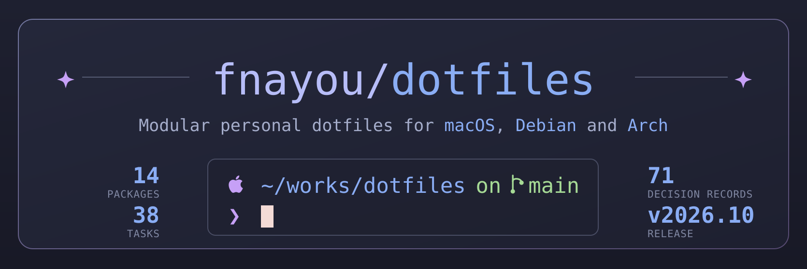

# dotfiles

<p align="center">
  
</p>

<p align="center">
  <a href="https://fnayou.github.io/dotfiles/">Documentation</a> ·
  <a href="https://fnayou.github.io/dotfiles/reference/architecture/">Architecture</a> ·
  <a href="#whats-included">Packages</a> ·
  <a href="#daily-commands">Commands</a>
</p>

Private, safe, cross-platform personal dotfiles for **macOS**, **EndeavourOS / Arch Linux**, and
**Debian** (trixie / 13+), managed with [GNU Stow](https://www.gnu.org/software/stow/).

Configs are version-controlled in `stow/common/` and `stow/macos/`, and only ever symlinked into `$HOME`
by a **deliberate, manual** Stow step — never automatically. Everything uses the Catppuccin Macchiato
palette with a blue accent.

| Platform | Role | Installs with |
|---|---|---|
| macOS | primary environment | Homebrew — `packages/Brewfile` |
| EndeavourOS / Arch Linux | also used, supported from the start | pacman, yay — `packages/arch/packages.txt` |
| Debian 13 (trixie) | runs on all servers | apt — `packages/debian/packages.txt` |

## Status

```
Claude Code operating layer:  complete
GNU Stow packages:            see stow/common/ and stow/macos/ (source of truth; arch/ and debian/ are empty)
Stowed to $HOME:              all stow/common/ packages, plus stow/macos/ghostty on macOS
Not stowed:                   other stow/macos/ packages (the Terminal.app profile is deployed with a task)
Home directory:               changed only by those symlinks and by tasks you run yourself
```

Stow is always a deliberate, manual step: dry-run first, install only after reviewing the output.

## Architecture at a glance

One technical picture shows how the repository, deployment and the machine fit together: governance,
the source of truth, deployment, what you get on the machine, and delivery. It is generated from this
repository, so it follows the packages, tasks, zsh layers and CI steps that exist today.

**[Open the architecture diagram →](https://fnayou.github.io/dotfiles/reference/architecture/)**

1. **Governance** — PRD → architecture → plan → review → build → review → commit, and only you approve a gate.
2. **Source of truth** — `stow/` packages, `packages/` install lists, `scripts/` and `Taskfile.yml`.
3. **Deployment** — always manual and dry-run first: Stow for symlinks, `task` syncs for files Stow cannot link.
4. **The machine** — symlinks in `$HOME`, then the shell, terminal and tools read their own config.
5. **Delivery** — one pull request per change, CI checks, then the docs site is built from `main`.

## What's included

Each package is self-contained and carries its own README. `stow/macos/` holds `ghostty` (stowed) and
`terminal` (not stowed); `stow/arch/` and `stow/debian/` are reserved for platform-specific packages and
are currently empty.

| Package | What it manages | Details | Guide |
|---|---|---|---|
| **alacritty** | Alacritty terminal — window, font, keybinds, Catppuccin Macchiato theme | [README](stow/common/alacritty/README.md) | [guide](docs/guides/alacritty-setup.md) |
| **bat** | bat pager — style, wrap, paging, Catppuccin Macchiato theme | [README](stow/common/bat/README.md) | [guide](docs/guides/bat-setup.md) |
| **btop** | btop resource monitor — theme, background, truecolor, vim keys, Catppuccin Macchiato theme | [README](stow/common/btop/README.md) | [guide](docs/guides/btop-setup.md) |
| **claude** | Claude Code status line — OS · model · path · git · PR/MR · context % · rtk savings segments, mirrors the Catppuccin Macchiato prompt | [README](stow/common/claude/README.md) | [guide](docs/guides/claude-setup.md) |
| **codex** | Codex CLI config — Catppuccin Macchiato blue syntax theme (stowed) plus a config template synced with `task codex:sync`, never stowed itself | [README](stow/common/codex/README.md) | [guide](docs/guides/codex-setup.md) |
| **eza** | eza `ls` replacement — Catppuccin Macchiato (Blue) color theme | [README](stow/common/eza/README.md) | [guide](docs/guides/eza-setup.md) |
| **ghostty** | Ghostty terminal — window, font, keybinds, Catppuccin Macchiato theme; macOS-only options in `stow/macos/ghostty` | [README](stow/common/ghostty/README.md) · [macOS README](stow/macos/ghostty/README.md) | [guide](docs/guides/ghostty-setup.md) |
| **git** | Portable Git config — settings, aliases, global ignore (no secrets) | [README](stow/common/git/README.md) | [guide](docs/guides/git-setup.md) |
| **herdr** | Herdr agent multiplexer — theme, terminal, UI, toast | [README](stow/common/herdr/README.md) | [guide](docs/guides/herdr-setup.md) |
| **nvim** | Neovim config — Catppuccin Macchiato (Lua), managed plugins | [README](stow/common/nvim/README.md) | — |
| **omp** | Oh My Posh prompt — segments + Catppuccin Macchiato palette | [README](stow/common/omp/README.md) | — |
| **terminal** | macOS Terminal.app profile — Catppuccin Macchiato colors and JetBrainsMono Nerd Font Mono; not stowed, deployed with `task terminal:sync` | [macOS README](stow/macos/terminal/README.md) | [guide](docs/guides/terminal-app-setup.md) |
| **zsh** | Layered Zsh config — path, history, plugins, tools, prompt, per-OS layers, go-task completion | [README](stow/common/zsh/README.md) | [guide](docs/guides/zsh-setup.md) |

## Daily commands

Everything goes through [`task`](https://taskfile.dev). `task --list` shows all of it. Commands that change
anything outside the repository are a dry run until you add `ARGS='--apply'`.

| Command | What it does |
|---|---|
| `task doctor` | read-only health check: is this machine set up the way the repo intends? |
| `task check` · `task detect` | verify `stow`, `git` and `task` are installed · print the detected OS |
| `task list` · `task dry-run AREA=common PACKAGE=zsh` | list Stow packages · dry-run one of them |
| `task deps:brew` · `deps:arch` · `deps:debian` | print the install commands for your platform; they never install |
| `task codex:sync` · `task terminal:sync` | merge the Codex template / import the Terminal.app profile — dry run by default |
| `task art:check` · `task art:build` | check / regenerate the banner, social preview, logo and diagram (see [the art guide](docs/guides/art-setup.md)) |
| `task check:decisions` | validate the ADR record, also run in CI |
| `task changelog` | regenerate `CHANGELOG.md` from Conventional Commits |
| `task hooks:status` | show whether the opt-in Git hooks (the art reminder) are enabled |

## Documentation

The public documentation site — overview, installation, features, usage, and reference — lives at
<https://fnayou.github.io/dotfiles/> (built with MkDocs Material from `website/`), including the
[architecture diagram](https://fnayou.github.io/dotfiles/reference/architecture/).

Setup guides are written for a human operator, not for agents.

- [Doctor](docs/guides/doctor.md) — `task doctor`, a read-only health check answering "is this machine set up the way the repo intends?".
- [Packages setup](docs/guides/packages-setup.md) — install the tools every package depends on (`git`, `stow`, `go-task`, …).
- [GNU Stow usage](docs/stow-usage.md) — dry-run workflow, install steps, conflict handling, adding packages.
- Per-package setup guides — [alacritty](docs/guides/alacritty-setup.md) · [art](docs/guides/art-setup.md) · [bat](docs/guides/bat-setup.md) · [btop](docs/guides/btop-setup.md) · [claude](docs/guides/claude-setup.md) · [codex](docs/guides/codex-setup.md) · [eza](docs/guides/eza-setup.md) · [ghostty](docs/guides/ghostty-setup.md) · [git](docs/guides/git-setup.md) · [herdr](docs/guides/herdr-setup.md) · [terminal-app](docs/guides/terminal-app-setup.md) · [zsh](docs/guides/zsh-setup.md).
- [Speed test setup](docs/guides/speedtest-setup.md) — optional `cloudflare-speed-cli` helpers (`speed`, `speed-json`, `speed-log`, `speed-history`) shipped by the zsh package.
- [Agent tooling setup](docs/guides/agent-tooling-setup.md) — optional `rtk`, `caveman`, and Matt Pocock's skills, and how each is activated in Claude Code, opencode, and Codex CLI. Not Stow packages.
- [Shell dependencies](docs/shell-dependencies.md) · [Zsh migration notes](docs/zsh-migration.md).

## Installing a package

Stow is always a manual, reviewed step. Dry-run first, install only after reviewing the output.

```bash
# Step 1 — dry run, review what would be linked
stow --dir=stow/common --target="$HOME" --simulate <package>
```

⚠️  MANUAL STEP — run only after approving the dry-run output

```bash
stow --dir=stow/common --target="$HOME" <package>
```

For a macOS-only package use `--dir=stow/macos`. Some packages need `--no-folding`: each package's guide
says which. If the dry run reports a conflict, **stop** and resolve it manually. Never use `--adopt` — it
overwrites existing files. See the [Stow usage guide](docs/stow-usage.md) for full detail.

## Safety

- All `stow/common/` packages, plus `stow/macos/ghostty` on macOS, are stowed; symlinks point from `$HOME` into the repo.
- Stow and symlink operations happen only with explicit per-session approval and a reviewed plan.
- Tasks that write outside the repository (`codex:sync`, `terminal:sync`, `hooks:install`) are a dry run first and need `--apply`.
- No secrets, credentials, or private hostnames are committed.
- Local-only and sensitive values live in unstowed `.example` templates that you copy and fill in.
- Every significant change follows: PRD → Architecture → Review → Plan → Review → Build → Review → Commit.
- Commits and pull request titles use [Conventional Commits](https://www.conventionalcommits.org/en/v1.0.0/).

## Generated art

The banner above, the social preview, the logo, the favicon and the architecture diagram are generated
from this repository by a small Python program, with a PNG rendered beside each SVG. CI fails a pull
request whose committed SVGs are stale, and a short reminder appears before you commit, push or open a
pull request when the art needs rebuilding. See the [art guide](docs/guides/art-setup.md).

## For Claude Code

Read `AGENTS.md` first — it is the main operating contract. It defines agent roles, the PRD-first
workflow, safety / privacy / cross-platform rules, the documentation workflow, and commit rules.

Do not implement dotfiles, run Stow, create symlinks, or modify `$HOME` without explicit user
approval and an approved plan.

## Repository structure

```
.claude/          Claude Code agents, rules, skills and the project hook
.githooks/        Opt-in Git hooks (task hooks:install)
.github/          CI and docs workflows
stow/
  common/         Packages that work on all platforms (source of truth)
  macos/          macOS-specific packages (ghostty is stowed, terminal is not)
  arch/           Arch / EndeavourOS-specific packages (empty)
  debian/         Debian-specific packages (empty)
packages/         Install lists per platform (Brewfile, Arch, Debian)
scripts/          Entry points behind the tasks, and the art generators (scripts/art/)
docs/
  guides/         Human setup guides, one per package
  architecture/   Structure decisions and tradeoffs
  decisions/      ADR-style decision records
  plans/          Ordered implementation plans
  prd/            Product requirements documents
  reviews/        Review reports
  claude/         Agent guides and workflow documentation
website/          The MkDocs site and its images
Taskfile.yml      Every task, the only entry point
AGENTS.md         Main operating contract — read this first
CLAUDE.md         Claude Code entry point
```

## CI

Two GitHub Actions workflows:

- **CI** runs on every push and pull request with non-destructive hygiene checks only: expected files
  and directories exist, Markdown is present, `bash -n` on shell scripts, a scan for obvious secret
  patterns, the ADR record is consistent, the status-line tests pass, and the committed SVG art is
  current. It never runs Stow, creates symlinks, modifies `$HOME`, uses secrets, or deploys anything.
- **Docs** runs on `main`: it generates the architecture diagram, builds the site with
  `mkdocs build --strict`, and deploys it to GitHub Pages.

## License

See `LICENSE`.
