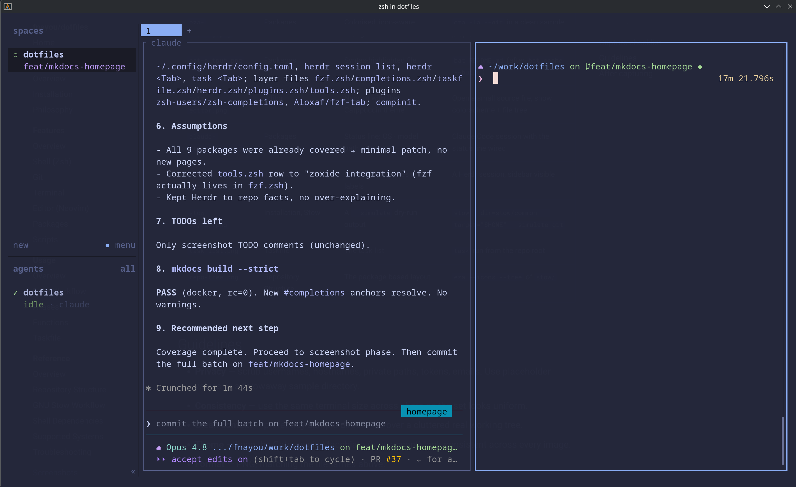

# Terminal

Three tools shape the terminal: **Alacritty** and **Ghostty** (two emulators, configured alike) and
**Herdr** (an agent-oriented multiplexer). All ship a Catppuccin Macchiato look with a blue accent,
consistent with the rest of the setup.

Curated from `docs/guides/alacritty-setup.md`, `docs/guides/ghostty-setup.md`, and
`docs/guides/herdr-setup.md`.

## Alacritty

The `stow/common/alacritty/` package manages two files in `~/.config/alacritty/`:

| File | Purpose |
|---|---|
| `alacritty.toml` | Window, font, keybindings, shell, theme import |
| `catppuccin-macchiato.toml` | Catppuccin Macchiato color theme |

Alacritty loads the config on startup — no activation step beyond stowing.

!!! note "macOS-specific lines are harmless on Linux"
    `option_as_alt = "Both"` (and the commented-out `decorations = "Buttonless"`) only affect macOS.
    Alacritty ignores inapplicable values gracefully on Arch and Debian.

!!! tip "Shift+Enter inserts a newline"
    A `keyboard.bindings` entry maps **Shift+Enter** to a newline (`\n`), matching macOS behavior for
    TUIs like Claude Code. macOS drops the modifier otherwise, so the binding makes it explicit; on
    Arch / Debian the native keyboard protocol already passes it through.

Dry-run, then apply (requires `--no-folding`):

```bash
stow --dir=stow/common --target="$HOME" --no-folding --simulate alacritty
```

⚠️  MANUAL STEP — review dry-run output before running
```bash
stow --dir=stow/common --target="$HOME" --no-folding alacritty
```

## Ghostty

Two packages, both named `ghostty`, manage files in `~/.config/ghostty/`. The common
`stow/common/ghostty/` package (macOS and Arch) mirrors the Alacritty settings:

| File | Purpose |
|---|---|
| `config.ghostty` | Theme selection, terminal type, window, scrolling, font, shell, key bindings |
| `themes/catppuccin-macchiato` | Catppuccin Macchiato color theme |

[macOS] The macOS-only `stow/macos/ghostty/` package adds one file:

| File | Purpose |
|---|---|
| `macos.ghostty` | macOS-only options — `macos-option-as-alt = true` (both Option keys act as Alt) |

Ghostty loads `config.ghostty` on startup — no activation step beyond stowing and a full restart.

!!! note "No macOS-only lines in the common file"
    The common `config.ghostty` has no `macos-*` option. It ends with the optional include
    `config-file = ?macos.ghostty`: Ghostty loads `macos.ghostty` when it is linked and skips it,
    with no error, when it is not. On Arch, stow only the common package. On macOS, stow both —
    with only the common package, Option is not Alt.

!!! warning "The Application Support file stays empty [macOS]"
    Ghostty also reads `~/Library/Application Support/com.mitchellh.ghostty/config.ghostty`, and
    its settings layer over the repository config. It is not managed here and must stay empty.
    Change settings only in the repository files.

Dry-run, then apply (requires `--no-folding` for both packages). `-v` prints the `LINK:` lines:

```bash
stow -v --dir=stow/common --target="$HOME" --simulate --no-folding ghostty
```

```bash
# macOS
stow -v --dir=stow/macos --target="$HOME" --simulate --no-folding ghostty
```

⚠️  MANUAL STEP — review before running
```bash
stow --dir=stow/common --target="$HOME" --no-folding ghostty
```

⚠️  MANUAL STEP — review before running
```bash
# macOS
stow --dir=stow/macos --target="$HOME" --no-folding ghostty
```

## Herdr

The `stow/common/herdr/` package manages a single file, `~/.config/herdr/config.toml` — Catppuccin
Macchiato blue UI tokens, terminal, UI, and toast settings. Herdr is an agent-oriented multiplexer; it loads
`~/.config/herdr/config.toml` automatically on startup, so there's no activation step beyond stowing.
The default shell is `zsh` and new panes follow the active pane's working directory.

The zsh package also ships **Herdr session-name completion** (`herdr <Tab>`) — see
[Completions](shell.md#completions).


*Herdr session layout for agent-oriented terminal work.*

!!! warning "Only `config.toml` is managed"
    Herdr also keeps session state and workspace data under `~/.config/herdr/`. The package manages
    **only** `config.toml`. Never remove the whole `~/.config/herdr/` directory — if there's an
    existing `config.toml`, back up and remove just that one file before stowing.

Dry-run, then apply (requires `--no-folding`):

```bash
stow --dir=stow/common --target="$HOME" --no-folding --simulate herdr
```

⚠️  MANUAL STEP — review dry-run output before running
```bash
stow --dir=stow/common --target="$HOME" --no-folding herdr
```

## Related

- [Shell (Zsh)](shell.md) — the prompt and shell that run inside the terminal.
- [GNU Stow Workflow](../reference/stow.md) · [Installation](../installation.md)
